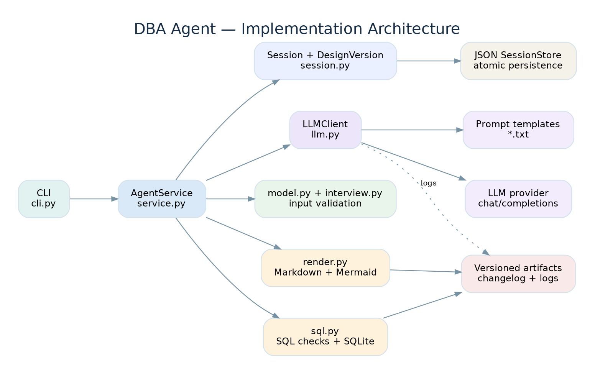
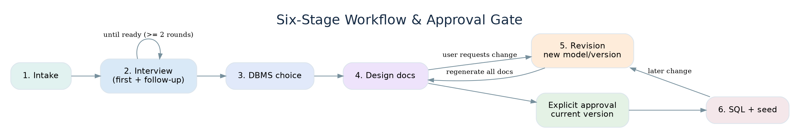

# DBA Agent — Revised Implementation Guide

*Source of requirements: the newly uploaded “DBA Agent — An LLM-Powered Database Design Assistant” specification. Code basis: the uploaded `DBA_AGENT-master(1).zip`, extended and tested in this revision. Implementation snapshot: 4 November 2026.*

## 1. Purpose, scope, and what changed

DBA Agent turns a free-text description of a proposed system into a relational database design and, following explicit approval, executable SQL and realistic seed data. The course specification defines six mandatory stages (intake, requirements interview, DBMS choice, design documentation, revisions, and SQL) plus persistence, separate prompts, provider configurability, LLM-call logs, and organized artifacts.

The **uploaded repository originally contained** `Session`, `SessionStore`, a requirements formatter/validator, a workflow contract, a small test file, and a placeholder README. It did **not** contain a usable CLI, LLM integration, DBMS selection implementation, design generation, revision propagation, or SQL generation. The revised repository extends those foundations rather than presenting the previous code as complete.

The two supplied project-description PDFs state essentially the same functional requirements but use different layouts. The revised implementation targets the full workflow specified in those documents. The tests presented here use an **offline scripted LLM**, not a live API. SQLite schema/seed execution is actually tested; other SQL dialects remain unverified by a real DBMS.

## 2. Architecture in one view

The implementation uses a lightweight, framework-free **layered orchestration** approach. The CLI handles user interaction, `AgentService` coordinates stages, `Session` owns domain state, `LLMClient` performs model calls, and validators/renderers convert responses into defensible data and documents. Prompt files stay outside Python source code.



```text
User / terminal
      |
      v
CLI (dba_agent/cli.py)
      |
      v
AgentService (dba_agent/service.py)  --------> Config (config.py)
      |                  |                            |
      |                  +----> LLMClient (llm.py) ----+--> dba_agent/prompts/*.txt
      |                              |                +--> API chat/completions
      |                              +--> llm-calls.jsonl
      |
      +----> Session / DesignVersion (session.py)
      |                 |
      |                 +----> SessionStore --> .dba_agent/sessions/<uuid>.json
      |
      +----> model.py + interview.py --> validation guards
      +----> render.py --> versioned Markdown + Mermaid + changelog
      +----> sql.py --> SQL checks + optional in-memory SQLite execution
```

**Key design rule:** the structured `Session` data and `DesignVersion.model` are the source of truth; Markdown and diagram text are derived. This reduces cross-file inconsistencies after revisions. SQL is produced by the model and checked, so consistency with the structured model is not mathematically guaranteed: SQL needs independent review and execution.

## 3. Folder structure and responsibilities

| Path | Responsibility |
|---|---|
| `dba_agent/session.py` | State machine, transitions, versioned designs, approvals, JSON storage. |
| `dba_agent/interview.py` | Seven required interview categories, substantive-answer validation, requirements Markdown. |
| `dba_agent/model.py` | Validate DBMS-choice structure, identifiers, tables, keys, foreign keys, dependencies and normalization declarations. |
| `dba_agent/config.py` | Read model/provider and runtime settings from environment variables. |
| `dba_agent/llm.py` | Load external prompts, request model JSON, parse replies, log each attempt. |
| `dba_agent/service.py` | Orchestrate all stages and checkpoint progress; revision and SQL repair loops. |
| `dba_agent/render.py` | Produce the six design Markdown files, ER diagrams and change log. |
| `dba_agent/sql.py` | Check table creation and population; run SQL against in-memory SQLite when requested. |
| `dba_agent/cli.py` | Human-facing CLI: `new`, `answer`, `continue`, `status`, `revise`, `approve`, `sql`. |
| `dba_agent/prompts/*.txt` | Editable prompts, separated by pipeline step. |
| `tests/` | Offline behavioral, state, regression and actual SQLite execution tests. |
| `docs/workflow-contract.md` | Intended workflow rules and stage contracts. |
| `docs/implementation-guide.md` | This actual-code guide. |
| `README.md` | Installation, provider configuration, example run and limitations. |

## 4. Domain model: Session, DesignVersion and state

### 4.1 `Stage` enumeration

`Stage` describes the current **lifecycle position**, not a database schema or an LLM reply. Its values are `NEW`, `INTAKE_COMPLETE`, `INTERVIEWING`, `REQUIREMENTS_COMPLETE`, `DBMS_SELECTED`, `DESIGN_READY`, `REVISION_PENDING`, `APPROVED`, and `SQL_GENERATED`.

```text
NEW -> INTAKE_COMPLETE -> INTERVIEWING
                                 | (repeat questions/answers)
                                 v
                         REQUIREMENTS_COMPLETE
                                 |
                           DBMS_SELECTED
                                 |
                            DESIGN_READY <---- revised design, new version
                                 |                    ^
                              APPROVED                 |
                                 |                    |
                           SQL_GENERATED -------------+
```



`REVISION_PENDING` exists in the state enumeration for compatibility with the original contract; the revised `revise()` method **validates and commits a complete revised model atomically**, so it transitions directly back to `DESIGN_READY`. There is no externally observable pending-review checkpoint with this value in the normal CLI flow.

### 4.2 `Session` dataclass: important attributes

| Attribute | What it stores | When it changes |
|---|---|---|
| `session_id` | Stable canonical UUID | When a session is created. |
| `state` | Current `Stage` | On a successful transition. |
| `created_at`, `updated_at` | UTC timestamps | Creation, mutations and saves. |
| `intake_text` | Original unstructured user description | Intake. |
| `intake_summary` | Structured actors, entities, processes, requirements, ambiguities | Intake. |
| `pending_questions` | Questions awaiting user answers | Question generation / answer submission. |
| `interview_rounds` | History of questions and answers | Every accepted round. |
| `interview_assessment` | Model completeness decision, coverage flags and contradictions | After each round. |
| `requirements` | Final seven-category requirements object | Interview completion and accepted revisions. |
| `dbms_choice` | Selected DBMS and comparison/justifications | DBMS selection and accepted revisions. |
| `versions` | List of versioned structured designs and file paths | Initial design and revisions. |
| `active_version` | Number of currently reviewed design | Revision. |
| `approval_version` | Approved version number or `None` | Approval; cleared on revision. |
| `revision_history` | User change request, rationale, version transition, regenerated files | Revision. |
| `metadata` | Future extensibility field | Not actively used by the present orchestration. |

### 4.3 `DesignVersion`

A `DesignVersion` has `number`, `model`, `artifacts` and `approved_at`. The `model` is a machine-readable schema with tables, columns, PKs, foreign keys, uniques, checks, indexes, relationships, functional dependencies, normal-form claims, assumptions, ambiguities and business-rule traceability. `artifacts` maps output file names to generated paths. `approved_at` records an explicit user approval timestamp. Revision creates a **new object** rather than overwriting an older model.

### 4.4 `Session` methods and transition guards

| Method | Input / output | Main rule |
|---|---|---|
| `touch()` | Updates timestamp | Called after state changes. |
| `design` property | Returns active `DesignVersion` | Raises if the version does not exist. |
| `complete_intake(text, summary)` | Stores summary, changes to `INTAKE_COMPLETE` | Requires `NEW`, nonempty text and five list fields. |
| `start_interview()` | Changes to `INTERVIEWING` | Requires completed intake. |
| `set_questions(questions)` | Stores next set of questions | Nonempty unique questions, no already-pending set. |
| `add_interview_round(questions, answers)` | Appends round, clears pending questions | Answers must match all question strings and be nonempty. |
| `assess_interview(assessment)` | Saves model assessment | Requires explicit readiness boolean, all seven coverage flags, contradiction list. |
| `complete_requirements(requirements)` | Stores final requirements, advances | At least **two answered rounds**, model ready, full category coverage, no critical contradictions, substantive values. |
| `requirements_markdown()` | Returns Markdown text | Only after requirements are completed. |
| `select_dbms(choice)` | Saves decision, advances | Exactly four supported systems compared, three rejection reasons. |
| `set_design(model)` | Saves validated design, advances | Valid structured schema, PKs/FKs, normalization entries. |
| `revise(model, reason, request, choice)` | New version, reset approval, record history | Requires valid model and nonempty request/reason; allowed after design/approval/SQL. |
| `approve()` | Records active version and timestamp | Only for `DESIGN_READY` with a model. |
| `require_sql_approval()` | Guard only, no mutation | State must be `APPROVED` for active version. |
| `mark_sql_generated()` | Marks successful SQL generation | Requires current approval. |
| `to_dict()`, `from_dict(data)` | JSON-compatible conversion | Reconstructs enum and versions; checks approval/version coherence. |

**Why two interview rounds?** The assignment explicitly mandates **at least one follow-up**. Round 1 gathers broad facts. Round 2 or later uses previous answers to clarify details and resolve ambiguity. Two rounds are a **minimum**, not an automatic stop condition. The agent's `ready` assessment must also be true and the seven coverage checks must pass. If the configured maximum rounds is reached while incomplete, the agent stops with an error instead of inventing missing information.

**Why approval is version-specific:** If version 1 is approved and the user then adds a new table, its old SQL approval cannot be reused. The new design is version 2, `approval_version` becomes `None`, and SQL generation is blocked until the user explicitly approves version 2.

## 5. Persistent storage and serialization

`SessionStore(root)` owns on-disk JSON files. `path_for(session_id)` accepts canonical UUIDs only, preventing path traversal by names such as `../secret`. `save(session)` updates its timestamp, writes a temporary JSON file, flushes and `fsync`s, and atomically replaces the final file. `load(id)` restores a `Session` using `from_dict`, or raises `StateError` on missing/corrupt data.

Example: a user closes the CLI after the first interview round. Their existing questions, answers and state remain in `.dba_agent/sessions/<uuid>.json`. On restart, `continue <uuid>` reads the same state and resumes question generation or the next stage. The store provides **atomic replacement** but not a multi-process transaction/locking mechanism; do not run multiple writers against one session concurrently.

## 6. Interview module and database terminology

`REQUIRED_CATEGORIES` contains seven `(key, heading)` pairs. `validate_requirements(requirements)` rejects absent or empty category values. `render_requirements_markdown(requirements, rounds)` produces `requirements.md` with category descriptions and the actual question/answer history. Internal helpers `_has_content(value)` and `_format_value(value)` validate nonempty material and display strings, lists or mappings.

| Term | Meaning | Example question / influence |
|---|---|---|
| **Entity** | Real-world concept to store persistently, usually becoming a table | Customer, Order, Product. |
| **Attribute** | Property of an entity, usually a column | `orders.created_at`, `customers.email`. |
| **Relationship** | Link between entities | One customer places many orders. |
| **Cardinality** | Number of related rows, e.g. 1:1, 1:N or M:N | One order contains many products through an order_items table. |
| **Data volume** | Amount of stored information and its expected growth | 50,000 users now; 15% growth annually. Helps with storage and indexes. |
| **Workload** | Frequency and nature of operations: reads, writes, joins and reporting | 1,000 order reads/minute, daily sales dashboards; affects indexes and DBMS fit. |
| **Transaction** | Unit of work that should succeed or fail as one unit | Create order + update inventory in one transaction. |
| **Consistency** | Invariants that must remain true after operations | Every loan references a valid book copy. |
| **Concurrency** | Multiple users/processes operating simultaneously | Two employees cannot reserve the last item at the same time. |
| **Security / privacy** | Who can access data, how roles and sensitive fields are protected | Only admins can view staff salaries. |
| **Business rule** | Domain-specific invariant or policy | Order amount must be positive; a user may have no more than five active loans. |
| **Primary key (PK)** | Unique identifier of a row | `orders.order_id`. |
| **Foreign key (FK)** | Integrity constraint referencing another table | `orders.customer_id` references `customers.customer_id`. |
| **Index** | Access structure improving selected queries, at write/storage cost | Index on `orders.customer_id` for order history queries. |

Volume and workload are different: *volume* concerns quantity and growth; *workload* concerns how the data is accessed or modified. Both are needed to evaluate SQLite versus client/server DBMSs, determine indexes, and plan reporting.

## 7. The six-stage runtime workflow

### Stage 1 — Intake

The CLI's `new "description"` calls `AgentService.create(description)`. That creates `Session()`, invokes `LLMClient.ask("intake", "intake", {"description": ...})`, validates the five output lists with `complete_intake()`, persists the result, starts the interview and requests first questions. The model must **mark uncertainties**, not hallucinate fields. The persisted session ID is printed in the terminal.

### Stage 2 — Interview

`AgentService.advance(id)` requests initial questions from `prompts/questions.txt`. The user answers them via `answer <id>` (interactive input) or `answer <id> --json answers.json`. `add_interview_round` persists the accepted round before one call to `prompts/assess.txt` assesses completeness and returns 1–3 targeted follow-up questions when needed. Full requirements are requested only when ready after at least two answered rounds. Assessment and its next action are validated together before checkpointing. Older saved assessments can still resume with a separate question call. Even if a model says ready after only one round, the code **requires another answered round**. Only after the second or later round, complete coverage, no critical contradictions and an affirmative model assessment can `complete_requirements` run.

A possible first round for an ordering system might ask about entities/attributes, customer-order cardinality, growth, query patterns, concurrent updates, access permissions and order constraints. A follow-up might ask whether an order can exist without a customer, how cancelled orders behave and how inventory transactions interact. These are illustrative questions, **not actual recorded LLM responses**.

### Stage 3 — DBMS choice

Once requirements are complete, `AgentService.advance()` calls the `dbms` prompt and validates `selected`, `rationale`, `comparison` and `rejected`. Exactly these names are supported: PostgreSQL, MySQL/MariaDB, SQLite and SQL Server. The decision must reflect the actual volume, write concurrency, transactions, security and deployment needs; `dbms-choice.md` preserves the four-way comparison. **The four DBMS options are alternatives for the user's eventual application—not the JSON state store used by DBA Agent itself.**

### Stage 4 — Design documents

`AgentService.advance()` requests one complete structured `design` object. `model.validate_design()` checks basic internal structure and referential integrity. `Session.set_design()` marks it `DESIGN_READY`. `render_session()` then creates six documents from the **same model** rather than prompting separately for each:

- `requirements.md`: seven categories plus interview transcript.
- `dbms-choice.md`: selected system, rationale, four-way comparison and rejections.
- `conceptual-model.md`: entities, relationships/cardinalities, Mermaid ER diagram.
- `logical-schema.md`: DBMS-specific types, columns, PKs, FKs, uniqueness, CHECKs, indexes, diagram.
- `normalization.md`: functional dependencies, claimed normal form for each table, justifications.
- `assumptions.md`: assumptions, unresolved issues and business rule -> implementation mapping.

**Important limitation:** `model.py` verifies the **shape** of these assertions, not semantic truth. A claim that a table is in 3NF can still be wrong; meaningful checking requires a DBA critique, and generated SQL should be inspected against both diagrams.

### Stage 5 — Revision loop

The user runs `revise <session-id> "change request"`. The revision prompt receives the current requirements, DBMS choice, model and natural-language request, and returns complete replacements for these structured objects plus a reason. The service validates **all proposed replacements before modifying the existing session**. `Session.revise()` increments the design version, clears approval, records the change, and returns the design to `DESIGN_READY`. The service regenerates all six current-version Markdown files and appends `changelog.md` in the session output folder. Prior version directories remain for comparison.

This deliberately uses **regeneration rather than independent textual patching**: if `customer.email` becomes unique, the logical schema, ER representation, normalization discussion, documented rules and eventually `schema.sql` must all agree. Previous `schema.sql` and `seed.sql` are **historical outputs**, not SQL for the new version; the new version has no SQL until approved and regenerated. A DBMS-switch request also updates the comparison and corresponding data types.

### Stage 6 — Approval, schema SQL and seed SQL

`approve(id)` calls `Session.approve()`: only a ready design can be approved, and the approval belongs to that exact version. `sql(id)` calls `require_sql_approval()` first, then asks the model for `schema_sql` and `seed_sql` in the chosen SQL dialect. The static checks assert that every table has a `CREATE TABLE` and an `INSERT INTO`. Static failures are sent back to a repair prompt, up to `DBA_AGENT_MAX_SQL_ATTEMPTS`. Generation writes both files and never executes them.

After generation, the user can call `execute-sql` for PostgreSQL, MySQL/MariaDB, SQL Server, or SQLite. Server DBMSs require an already-running container, its image present locally, and a `psql`, `mysql`/`mariadb`, or `sqlcmd` client. SQLite writes to a user-selected database file using Python's built-in driver and needs no image. The command executes the saved schema first, then the seed, stopping on errors. It never pulls or installs an image or starts a container. `verify-sqlite` separately runs the files in memory with foreign keys enabled, compares the catalog against the design and checks row counts and foreign keys.

The two SQL files are published and the session transitions to `SQL_GENERATED` only after static checks succeed. The model is specifically instructed to populate **every table**, use realistic values, respect foreign-key insertion order, and exercise optional relationships, join tables and edge cases where relevant. These quality requirements remain essential during manual review.

## 8. Other classes and functions

### `Config` (`config.py`)

A frozen dataclass containing `base_url`, `model`, `api_key`, state/output/prompt paths, network timeout, LLM retry count, maximum interview rounds and maximum SQL repair attempts. `Config.from_env()` reads `DBA_AGENT_*` variables without editing Python code. Point `DBA_AGENT_BASE_URL` at an **OpenAI-compatible** gateway; alternate protocols need another transport implementation.

### `LLMClient` (`llm.py`)

The constructor accepts a `Config` and optional injected `transport`. `_http()` makes a standard HTTP POST to `<base_url>/chat/completions` with the model/messages JSON; it includes a bearer authorization header only when an API key is configured, allowing eligible Kilo free models to be used anonymously. `ask(stage, prompt, payload)` reads the matching prompt text file, sends a request, parses a JSON-object reply, retries failed calls a limited number of times and writes **one JSONL record per attempt**: stage, prompt, attempt, model, input, output or error. `parse_json()` handles plain JSON and a fenced JSON object; `append_jsonl()` writes structured logs. The API key is not included in logs, but **user prompts, requirements and model responses are logged locally**, so access to output folders should be restricted when data is confidential.

### `AgentService` (`service.py`)

`__init__` wires config, LLM and JSON store; `get` loads sessions; `_save` persists them; `create` runs intake and starts the interview; `advance` resumes incomplete work, generates/assesses questions, then selects a DBMS and creates the design; `answer` submits answers and continues; `revise` performs a validated full replacement; `approve` records user approval; `generate_sql` invokes SQL generation, table-coverage checks, bounded static repair and final persistence; and `execute_sql` runs the saved files only when separately requested.

### `model.py`, `render.py`, `sql.py`, `cli.py`

`validate_dbms_choice()` checks the supported choices, all comparison rows and rejected alternatives. `validate_design()` checks table and column identifiers, uniqueness of names, nonnullable primary keys, references to existing columns/tables and candidate keys, FK actions, index column lists, relationship endpoints, normalization entries, and functional-dependency references.

`render.py` provides `choice_markdown`, `diagram`, `conceptual_markdown`, `logical_markdown`, `normalization_markdown`, `assumptions_markdown`, `changelog_markdown`, and `render_session`, plus formatting/writing helpers. `sql.py` provides `validate_sql_artifacts` and `execute_sqlite` (which also compares the executed SQLite schema with the structured design when a model is supplied). `cli.py` provides `main` to parse commands and `show` to display state/questions.

## 9. How JSON answers, documents, and sessions relate

A **session** is one durable design conversation. It contains one source description, all interview rounds, requirements, the latest DBMS decision and a list of design versions. An **interview round** is an ordered group of question strings plus a mapping from each question string to its answer. After each round the model returns an **assessment**. An **artifact** is a human-readable file generated from a specific version. Versions record the design's evolution; the session ID stays constant.

```text
Session 6a3... (same ID across steps)
  intake_summary
  interview_rounds[0]: initial questions + answers
  interview_rounds[1]: follow-up questions + answers
  interview_assessment: ready + seven coverage flags
  requirements
  dbms_choice
  versions[0] -> design version 1 -> six Markdown files -> explicit approval -> SQL
  versions[1] -> design version 2 -> regenerated Markdown files -> new approval -> new SQL
  revision_history -> changelog.md
```

This separation matters because **history is not state**: the interview transcript explains where requirements came from, while `requirements` is the current consolidated answer used by downstream stages. Likewise, the active model is the structured source of truth; Markdown is its readable representation.

## 10. Normalization and integrity: concepts used by the agent

**First normal form (1NF)** requires a well-defined row/column structure with atomic values, rather than storing a variable-length set of independent items inside one cell. An order's multiple products should normally be separate `order_items` rows, not a single comma-separated product list.

**Second normal form (2NF)** builds on 1NF by avoiding partial dependency of a non-key attribute on only part of a candidate key. In a table keyed by `(order_id, product_id)`, `product_name` depends on `product_id`, not the full pair, and belongs in a product table.

**Third normal form (3NF)** builds on 2NF by avoiding transitive dependency of non-prime attributes on keys: if `employee_id -> department_id -> department_name`, then storing `department_name` in each employee row introduces update anomalies. Put department data in a separate table and reference it with an FK. The precise formal definition is expressed through functional dependencies, candidate keys and prime attributes, so this summary is conceptual.

A **functional dependency** `X -> Y` means rows with the same X cannot have different Y in a valid database state. In the example, `customer_id -> customer_name`. The generated `normalization.md` lists such dependencies and each table's asserted normal form. **Human review is required**, because the agent's validator cannot prove that the functional dependencies are complete or that the asserted 3NF is correct.

Constraints reflect business rules: `NOT NULL` requires a value, `UNIQUE` forbids duplicates under the DBMS's null rules, `CHECK` encodes a condition, and `FOREIGN KEY` ensures references exist. `ON DELETE RESTRICT` prevents deletion when child rows exist; `CASCADE` propagates deletion and can be unsafe for financial history; `SET NULL` only makes sense for nullable FKs. Transaction isolation, locking and concurrency remain essential when rules involve multiple rows or steps and cannot be captured by a single SQL constraint.

## 11. Installation and one complete command sequence

The project requires Python 3.10+ and network access to a compatible LLM gateway. Kilo's eligible free models allow anonymous access; other models and gateways may require an API key. From the repository directory:

```bash
python -m venv .venv
source .venv/bin/activate        # Windows: .venv\Scripts\activate
python -m pip install -e .
export DBA_AGENT_BASE_URL=https://ai-gateway.kilo.ai/api/v1
export DBA_AGENT_MODEL=kilo-auto/free
# Optional for eligible free models; required for authenticated/paid models.
# export DBA_AGENT_API_KEY=YOUR_KILO_GATEWAY_KEY
python -m unittest discover -v
```

Start a real session:

```bash
python -m dba_agent.cli new "A small library manages books, physical copies, members, reservations and loans."
python -m dba_agent.cli answer SESSION_UUID    # answer displayed first-round questions
python -m dba_agent.cli answer SESSION_UUID    # follow-up round; repeat if needed
python -m dba_agent.cli status SESSION_UUID
python -m dba_agent.cli revise SESSION_UUID "Members can renew loans up to two times"
python -m dba_agent.cli approve SESSION_UUID
python -m dba_agent.cli sql SESSION_UUID
```

The last command creates SQL for whichever DBMS the model chose. After both files exist, run `python -m dba_agent.cli execute-sql SESSION_UUID --container CONTAINER --database DATABASE --user USER` for PostgreSQL, MySQL/MariaDB or SQL Server, with `DBA_AGENT_SQL_PASSWORD` set privately. The named container must already be running and its image must be local. For SQLite, run `python -m dba_agent.cli execute-sql SESSION_UUID --database path/to/database.sqlite`; no image is required. `verify-sqlite SESSION_UUID` remains available for an in-memory check. Use `continue SESSION_UUID` to resume a session interrupted before the design is ready.

## 12. Observability, testing, and reliability

The default state folder is `.dba_agent/sessions/`; generated files and logs are stored under `output/`. All six initial design docs appear under `output/<uuid>/v1/`; revisions create `v2`, `v3`, etc. `changelog.md` sits under the session output root, while `llm-calls.jsonl` and `sql-validation.jsonl` sit at the global output root.

Run `python -m unittest discover -v`. The included offline tests cover the session JSON round-trip, minimum follow-up, agent-controlled completeness, approval invalidation, invalid/unsafe session IDs, a complete six-stage scripted pipeline, SQL generation only after approval, genuine SQLite catalog comparison, foreign-key enforcement and seed counts, revision propagation into a new version, rejection of invalid revised schemas, and bounded SQL repair when a seed misses a table.

The test client injects a **scripted transport** rather than sending requests to a live API. Therefore, the tests verify orchestration and file/SQL behavior but **do not verify how consistently a particular live model follows the prompts**, which needs a separate integration test with real credentials.

## 13. Requirements coverage and remaining work

| Assignment requirement | Implementation status | Evidence / qualification |
|---|---|---|
| Stage 1: structured intake | Implemented | `Session.complete_intake`, `AgentService.create`, intake prompt. |
| Stage 2: seven categories plus self-terminating follow-up | Implemented with model assessment and deterministic guards | `Session.assess_interview`, `complete_requirements`; behavior still depends on model quality. |
| Stage 3: four DBMS alternatives with rationale | Implemented | `select_dbms`, `validate_dbms_choice`, `dbms-choice.md`. |
| Stage 4: four mutually consistent design documents | Implemented as deterministic renderers from one schema model | Mermaid diagrams, PK/FK checks; *semantic* correctness needs manual validation. |
| Stage 5: propagate revisions, changelog, explicit approval | Implemented | New full-model version, all six Markdown regenerated, approval invalidated. |
| Stage 6: schema.sql and mandatory seed.sql | Implemented with static checks | Generation does not execute SQL. Separate execution supports all four DBMS choices. |
| Persistence | Implemented | Atomic JSON session files, resume command. |
| Separated prompts | Implemented | Eight editable `dba_agent/prompts/*.txt` files. |
| LLM-call attempt logging | Implemented | `output/llm-calls.jsonl`, including errors. |
| Configurable model/provider | Implemented for compatible chat-completions APIs | Environment variables; other protocols need adapters. |
| Git/README/output folders | README and organized output implemented | Zip contains source; commit/push to the student's repository is still their action. |
| Complete scenario output | Not yet demonstrated | A comprehensive `scenario.md` is included, but its full live output still needs to be generated and reviewed. |
| Short architecture report (max ~3 pages) | Not supplied as separate submission file | This comprehensive guide is **not** a substitute for the required concise report. |
| Genuine critique of three flaws | Not supplied as separate submission file | Must identify actual flaws in a run, fix them, and document evidence. |
| Bonus real-DBMS validation/repair loop | Static repair only | Separate execution does not feed database errors back into the model. |

## 14. Design limitations and recommended next steps

**First:** run an actual end-to-end test against the LLM gateway using the included `scenario.md`. Inspect every stage and document; models can return invalid JSON or unsupported SQL even when deterministic validators are present.

**Second:** test generated `schema.sql` followed by `seed.sql` on a fresh instance of the *selected* DBMS, with keys/constraints enabled. Use `execute-sql` with an existing local-image container for PostgreSQL, MySQL/MariaDB or SQL Server, or a selected database file for SQLite. Do not claim successful SQL execution from lexical checks alone.

**Third:** strengthen the design validator by checking that relationship/cardinality declarations match actual FKs and bridge tables, and that all requirements have traceability links into tables/constraints. Investigate potential name collisions, dialect-specific type restrictions and SQL injection in generated scripts before using outputs outside a sandbox.

**Fourth:** add database-backed state storage or file locking for simultaneous users, improve prompt-injection defenses, restrict sensitive logs, and use a structured output format with stronger JSON-schema enforcement if supported by the selected provider. Current plain prompt instructions are not a proof of model response reliability.

**Fifth:** prepare the remaining assignment deliverables: a short architecture report, an authentic critique identifying at least three observed problems and repairs, and an official scenario output directory. The provided `tests/test_pipeline.py` is a regression demonstration, not a substitute for evidence from the external scenario.

## 15. Final explanation for a project defense

The project deliberately **separates domain state from LLM reasoning**. The LLM is useful for interpreting ambiguous user needs, asking follow-ups and proposing a relational design, but its output is treated as untrusted structured input. `Session` enforces legal transitions, `AgentService` controls ordering, `model.py` validates structural invariants, `render.py` keeps documents derived from one model, and version-specific approval prevents old designs from silently producing new SQL. The architecture is easy to explain, test offline, and extend without committing to a heavyweight agent framework.

The strongest remaining engineering challenge is **semantic correctness**: no amount of well-formatted Markdown or JSON validation proves that user requirements have all been captured, that the schema is in 3NF, or that SQL is valid on an untested target DBMS. That is exactly why the assignment requires realistic seed data, an authentic critique and executable validation.
